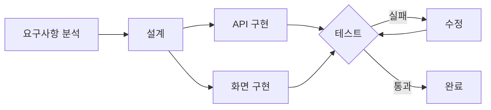

## Agentic Workflow

> AI가 여러 단계를 거쳐 작업을 수행하는 흐름

하나의 목표나 요구사항을 전달하면, AI가 목표 달성에 필요한 작업들을 여러 단계로 나누고, 각 작업의 순서와 관계를 구성하여 최종 목표를 달성하는 작업 흐름이에요.

## Agent Orchestration

> 여러 AI 에이전트의 역할과 작업 순서를 조율하는 것

여러 AI 에이전트에게 역할과 작업을 분배하고, 각 에이전트의 실행 순서와 결과물을 조율하여 하나의 목표를 달성하도록 관리하는 것이에요.

| 개념 | 의미 |
| :--| :--|
| Agent | 실제 작업을 수행하는 주체 |
| Orchestrator | Agent들의 역할과 작업을 조율하는 주체 |
| Orchestration | 전체 조율 과정 | 

## Loop Engineering

> 결과를 확인하고 수정하는 반복 구조를 설계하는 것

AI 가 작업한 결과를 확인하고, 부족하거나 잘못된 부분을 수정한 뒤 다시 실행하는 반복 구조를 설계하는 것이에요. 다시 말해 AI 에게 한번에 완벽한 결과를 기대하는 게 아니라, 결과를 확인하고 계속 개선하도록 만드는 거예요.

## Graph Engineering

> 작업의 순서, 조건 분기, 반복 관계를 그래프로 설계하는 것

작업을 일렬로 나열하는 대신, 각 작업을 **노드(Node)** 로, 작업 사이의 연결을 **엣지(Edge)** 로 표현해 전체 흐름을 그래프로 설계하는 것이에요.

| 요소 | 의미 | 예시 |
| :-- | :-- | :-- |
| 노드(Node) | 하나의 작업, 또는 그 작업을 맡은 Agent | 구현, 테스트 |
| 엣지(Edge) | 다음 작업으로 넘어가는 연결 | 구현 → 테스트 |
| 조건 분기 | 결과에 따라 다른 노드로 이동 | 통과 → 완료, 실패 → 수정 |
| 사이클(Cycle) | 이전 노드로 되돌아가는 연결 | 수정 → 다시 테스트 |

예를 들어 로그인 기능 구현을 그래프로 나타내면 이렇게 돼요.

- **의존성**: 설계가 끝나면 API와 화면을 동시에 구현할 수 있고, 테스트는 두 작업이 모두 끝나야 시작해요.
- **조건 분기**: 테스트 결과에 따라 완료로 가거나 수정으로 가요.
- **반복**: 수정 후 다시 테스트로 돌아가요. Loop Engineering에서 설계한 반복이 그래프에서는 이렇게 되돌아가는 화살표로 표현돼요.

LangGraph 같은 프레임워크가 이런 방식으로 노드와 엣지를 정의해서 Agent의 작업 흐름을 구성해요.

## 4가지 개념 연결하기

| 개념 | 핵심 질문 | 핵심 역할 |
| :--| :--| :-- |
| Agentic Workflow | 어떤 작업을 진행할까? | 전체 작업 흐름 설계 |
| Agent Orchestration | 누가 작업할까? | Agent 역할 및 실행 조율 | 
| Loop Engineering | 어떻게 반복 개선할까? | 검증과 수정 반복 구조 | 
| Graph Engineering | 작업들이 어떻게 연결될까? | 노드와 연결 관계 설계 |

하나의 AI 개발 시스템 안에서 함께 활용할 수 있는데요.
예를 들어 로그인 기능을 구현하는 AI 시스템에서
- Workflow 로 전체 작업 단계를 정하고, 
- Orchestration 으로 여러 Agent 에게 역할을 나누고, 
- Loop 로 테스트와 수정을 반복하고, 
- Graph 로 작업 간 의존성과 분기를 표현할 수 있어요.