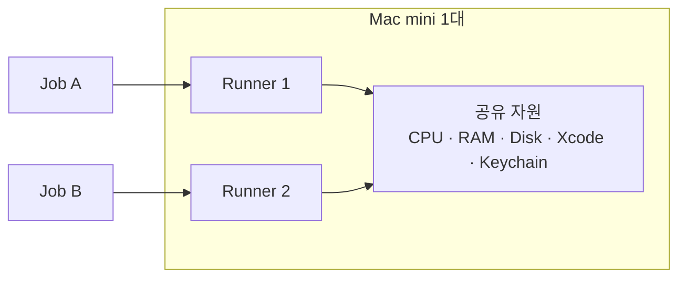
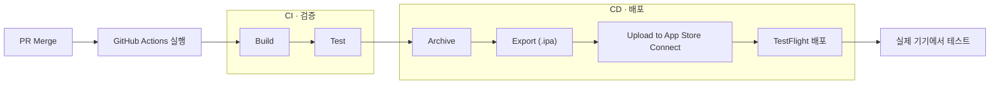

## 용어 정리

| 용어 | 설명 | 명령어 / 결과물 |
| :-- | :-- | :-- |
| Compile | 소스 코드를 기계가 실행할 수 있는 형태로 변환하는 과정 | |
| Build | 소스 코드를 실행 가능한 프로그램 형태로 만드는 과정. 컴파일과 리소스 처리 등을 포함한 전체 작업 | `xcodebuild build` |
| Artifact | Build 결과로 만들어진 파일 | `.app`, `.xcarchive`, `.ipa`, 테스트 결과 |
| Test | 앱이 정상적으로 동작하는지 확인하는 과정 (Unit Test, UI Test, Integration Test) | `xcodebuild test` |
| Archive | 배포를 위한 형태로 앱을 빌드하고 패키징하는 과정 | `xcodebuild archive` → `.xcarchive` |
| Export | Archive 결과물에서 배포용 앱 파일을 만드는 과정 | `xcodebuild -exportArchive` → `.ipa` |
| TestFlight | 개발 중인 앱을 테스터에게 배포하는 Apple의 서비스 | |
| Deploy | 만들어진 프로그램을 실제 서비스 환경에 배포하는 것 | |
| Workflow | 특정 조건에 따라 실행되는 자동화 작업의 정의 또는 흐름 | `.github/workflows/`의 YAML 파일 하나 |
| Job | Workflow를 이루는 작업 단위. Job 하나는 Runner 하나에서 실행되고, 그 안의 명령 하나하나를 Step이라고 함 | |
| Pipeline | CI/CD 작업이 진행되는 전체 흐름 | |

## 1. CI/CD란?

CI/CD는 개발자가 작성한 코드를 자동으로 검증하고, 앱을 배포하는 과정을 자동화하는 방법이에요.
- CI (Continuous Integration): 코드를 통합할 때 자동으로 빌드하고 테스트해요.
- CD (Continuous Delivery / Deployment): 검증된 결과물을 배포할 수 있도록 준비하거나 실제로 배포해요.

예를 들어 개발자가 GitHub에 Pull Request를 올리면 CI가 자동으로 빌드와 테스트를 실행하고, main 브랜치에 병합되면 배포하는 식이에요.

## 2. Runner란?

Runner는 GitHub Actions에서 Job을 실제로 실행하는 컴퓨터예요.
iOS 앱을 빌드하려면 macOS와 Xcode가 필요하기 때문에 macOS Runner를 사용해요.
Runner는 크게 두 종류가 있어요.

| 구분 | GitHub-hosted Runner | Self-hosted Runner |
| :-- | :-- | :-- |
| 장비 | GitHub가 관리하는 가상 머신 | 직접 준비한 Mac (Mac mini 같은 물리 장비) |
| 관리 | 별도 Mac 서버를 관리할 필요가 없음 | Xcode 버전이나 실행 환경을 직접 관리 |
| 지정 방법 | `runs-on: macos-latest` | `runs-on: [self-hosted, macOS]` |

## 3. Multi Runner

Mac mini 한 대에 Runner를 여러 개 설치해도 장비 자체는 하나이기 때문에 일부 자원을 공유해요.
- 공유 자원: CPU, RAM, Disk, Xcode, Keychain

따라서 다음 항목을 관리해야 해요.

| 항목 | 주의할 점 | 권장 방법 |
| :-- | :-- | :-- |
| Working Directory | 작업 파일 충돌 | Runner별 분리 |
| DerivedData | 빌드 결과물 충돌 | `-derivedDataPath`로 분리 |
| Simulator | 기기 상태 및 테스트 간섭 | Runner별 Simulator UDID 분리 |
| Xcode | 버전 변경으로 인한 간섭 | `DEVELOPER_DIR` 지정 |
| Keychain | 인증서 및 서명 작업 간섭 | 별도 관리 또는 직렬화(한 번에 하나씩 실행) |
| CPU / RAM | 동시 빌드로 인한 성능 저하 | 동시 실행 수 제한 |

## 4. iOS CI/CD 전체 흐름

PR이 main 브랜치에 병합되면 GitHub Actions가 아래 순서로 실행돼요.

